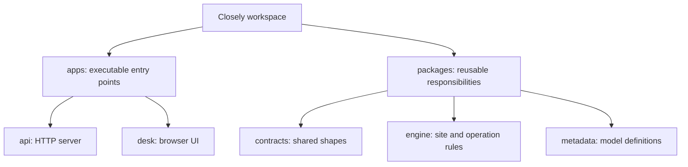
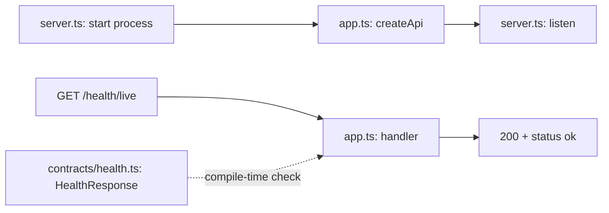

# Closely — growing project map

Date: 2026-10-12. User requested a gradual explanation of every existing apps/packages folder and file before further coding. Source reviewed read-only; no commands assigned. This map describes actual files and labels unfinished connections. Explanation does not establish understanding or execution evidence.

## Tour sequence

1. apps versus packages; existing five project folders; apps/api file purposes and liveness cycle — explained.
2. apps/desk browser startup and build cycle — pending; user chose engine first.
3. packages/contracts shared shapes and compiler/runtime distinction — pending detailed walkthrough.
4. packages/engine site configuration, registry, hostname and operation context connections — explained after API at user request.
5. packages/metadata types and immutable construction versus document values — pending detailed walkthrough.
6. Combined production flow versus test-only flow, builds/public exports and generated outputs — pending synthesis.

## Existing organization

Apps are executable entry points with process/browser responsibilities. Packages provide reusable responsibilities to callers. Neither parent directory itself executes code. One workspace links the individual named projects.

This is an organization tree, not a runtime request flow. Browser Desk currently renders only a heading; it does not call API. API production registers only liveness. Site/context functionality is exercised through test-only routes. Engine does not import metadata yet.

## First expanded node: apps/api

Purpose: adapt HTTP requests to framework operations and translate results into HTTP responses. Process startup/shutdown belongs here; site/domain rules belong to engine so future CLI/jobs can reuse them.

- src/server.ts: executable Node entry; calls createApi, listens at127.0.0.1:3000, registers SIGINT/SIGTERM shutdown, bounds shutdown with10-second deadline, logs failures. These are inspected code paths, not newly verified execution.
- src/app.ts: createApi constructs a fresh Fastify instance, enables logging, disables proxy trust and registers GET /health/live returning status ok. It does not listen; tests can create instances without binding ports.
- src/resolve-request-site.ts: HTTP adapter parses direct Host authority/optional port, passes hostname to supplied engine registry, maps malformed/unknown to400/404, propagates unexpected failures. Production app does not yet call it.
- src/app.test.ts: injects liveness request and checks200/body; closes its instance afterward. Inject is in-process testing, not listener verification.
- src/resolve-request-site.test.ts: builds test registry and test-only routes; checks two-host routing, ignored override headers, malformed/unknown hosts, unexpected errors, site-independent liveness and distinct Guest contexts.
- src/engine-public-entry.test.ts: imports @closely/engine public entry and composes unknown configuration decoder -> registry -> lookup, checking public package consumption rather than HTTP.
- package.json: names project @closely/api, declares Fastify/engine dependencies and contracts devDependency, scripts for checking/testing/build/start; Nx tags identify platform/server app.
- tsconfig.json: inherits strict root compiler rules; Node ESM source/test checking, Node globals, src input/dist output.
- tsconfig.build.json: extends local config for deployable build; excludes tests and prevents emission when compilation errors exist.
- dist/: generated JavaScript from source, currently app.js/server.js/resolve-request-site.js. start executes dist/server.js. Presence alone is not fresh execution; emitted unused adapter does not register a route.

Why separate server/app: port/process ownership versus reusable app construction. Why separate HTTP adapter/engine: Fastify headers/status codes versus transport-independent hostname/site policy. Why separate tests: examples are exercised by test tooling and excluded from shipped compilation.

Fastify serializes the handler result as the response. No engine, metadata, storage or actor lookup participates in this liveness route.

## Authored-file inventory for remaining nodes

apps/desk:

- index.html
- src/main.tsx
- src/App.tsx
- vite.config.mjs
- package.json
- tsconfig.json

packages/contracts:

- src/health.ts
- package.json
- tsconfig.json

packages/engine:

- src/decode-site-registrations.ts and .test.ts
- src/site-hostname.ts and .test.ts
- src/site-registry.ts and .test.ts
- src/operation-context.ts and .test.ts
- src/index.ts
- package.json
- tsconfig.json
- tsconfig.build.json

packages/metadata:

- src/doctype-definition.ts
- src/create-doctype-definition.ts and .test.ts
- src/index.ts
- package.json
- tsconfig.json
- tsconfig.build.json

All five projects have generated dist outputs at inspection. Server packages emit JavaScript and library declarations; Desk emits index.html plus a hashed JavaScript asset. Explain these after the authored source and build configurations. No additional hidden authored files found by read-only inventory excluding generated/dependency directories.

## Implementation checkpoint retained

Immutable metadata construction checked with user-supplied3-test batch/exit0. Name/field normalization, reserved/duplicate validation, registry and full metadata behavior remain pending. Tour does not advance product parity or authorize assistant implementation.

## Expanded node: packages/engine

User selected engine next, before Desk. Source/config/test inventory reviewed read-only; no checks executed.

Purpose: transport-independent framework rules reusable by HTTP, future CLI/jobs/scheduler/scripts. Current engine has site and operation-context foundations, not yet document saving/permissions/transactions. It does not start a process or import Fastify/React/metadata.

### Files and responsibilities

- src/decode-site-registrations.ts: unknown configuration -> exact expected object/string checks -> independent typed registrations. Does not load a file, prove authority, normalize hostname grammar or detect duplicates.
- src/site-hostname.ts: shared ASCII hostname validation/canonicalization; registration and lookup both lowercase/remove one root dot and validate labels. Kept internal to engine public package.
- src/site-registry.ts: constructs a private Map of normalized hostname -> siteName; rejects normalized duplicates; returned lookup method distinguishes malformed hostname error from valid unknown_site result. Returns SiteContext with siteName only, not a database connection.
- src/operation-context.ts: site/Guest-or-user actor/operation ID/source types and copied/frozen runtime constructor; checks supported variants/nonblank identifiers. Does not resolve hostname, authenticate users or authorize actions.
- src/index.ts: explicitly exports intended public functions/types; consumers import @closely/engine. Exporting functions neither executes them nor wires HTTP routes.
- src/decode-site-registrations.test.ts: valid/empty configuration, malformed/extra/inherited fields, copied values and decoder-versus-registry responsibility.
- src/site-hostname.test.ts: supported canonicalization/grammar/length boundaries and rejected inputs.
- src/site-registry.test.ts: two-site lookup, unknown result, duplicate detection including normalized duplicates, registration snapshot and malformed-versus-unknown distinction.
- src/operation-context.test.ts: Guest construction, copied/frozen context, invalid identifiers/discriminants and supported sources.
- package.json: @closely/engine name, ESM identity, three compiler/test/build scripts, Nx platform/engine/server tags and public entry pointing to dist/index.js plus dist/index.d.ts. No start script because caller applications execute its functions.
- tsconfig.json: source and test typechecking, NodeNext ESM rules, source root/dist output, declarations, inherited strictness and Node ambient types used by test tooling.
- tsconfig.build.json: extends check config; excludes tests and removes implicit Node ambient type inclusion for the current portable engine implementation. This setting is not an import/security boundary.
- dist/: generated index.js, decode-site-registrations.js, site-hostname.js, site-registry.js, operation-context.js, and each matching .d.ts. JavaScript executes; declaration files describe types to consumers. Type-only declarations produce no corresponding runtime values. Presence is not execution evidence.

### Setup and per-operation paths

Server-owned configuration is decoded, then a registry is built. Registry normalizes registrations into a private map. On lookup the same normalizer processes a hostname; the registry consults its existing map. Decoding/building need not repeat for every request.

HTTP is responsible for extracting Host/port via apps/api/src/resolve-request-site.ts. Engine registry accepts hostname only. Adapter translates expected domain results to HTTP failures. Successful SiteContext can be combined with an explicitly supplied actor, ID and source using createOperationContext. HTTP test fixture supplies Guest, request.id and http; production app does not yet wire this path.

Context example: site alpha, guest actor, request-1 operationId, http source. Site identifies tenant; actor identifies who is acting; ID correlates one operation; source identifies its entry point. SiteName is not user identity, authentication or database isolation. Future authentication must establish a user before supplying userName; future engine authorization must separately decide permitted actions.

Tests currently show composition through test-only routes; production API remains liveness-only and Desk is not connected. No new execution or parity evidence added by this tour.
